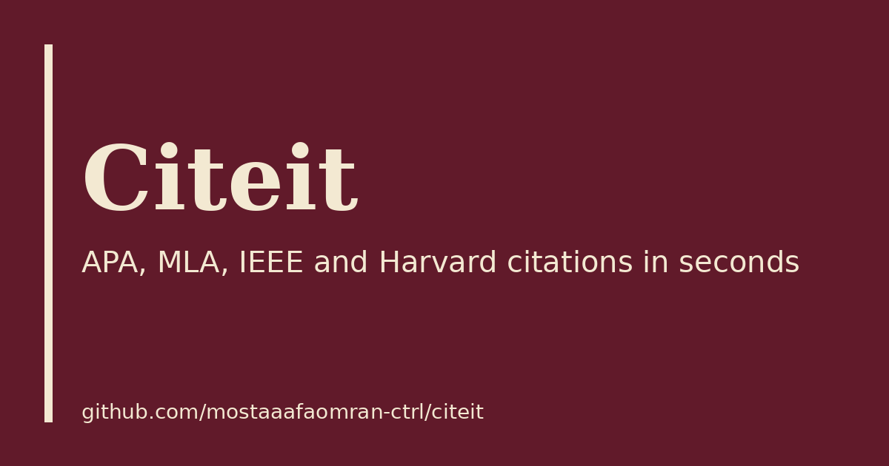

# Citeit

APA, MLA, IEEE and Harvard citations in seconds.

 

**Live demo:** https://mostaaafaomran-ctrl.github.io/citeit/ (add `?demo=1` to see it filled with sample data)

Citation generator for websites, books and journal articles in APA 7, MLA 9, IEEE and Harvard. Build a bibliography and copy it. Offline.

## Features

- Four styles: APA 7, MLA 9, IEEE, Harvard
- Website, book and journal article forms
- Bibliography sorted alphabetically, copy with italics kept
- Switch style without retyping
- Saved on your device only

## Run it locally

It is one `index.html` file. Open it in a browser. No build step, no dependencies, no server.

## Privacy

Everything runs in your browser. Nothing is uploaded. Data you enter is kept in your browser's local storage on your device only.

## بالعربي

مولّد مراجع لمواقع وكتب ومقالات بأنماط APA وMLA وIEEE وHarvard، مع قائمة مراجع تنسخها مرة واحدة.

افتح الملف `index.html` في المتصفح وهيشتغل على طول، من غير تسجيل ومن غير سيرفر.

## License

MIT
